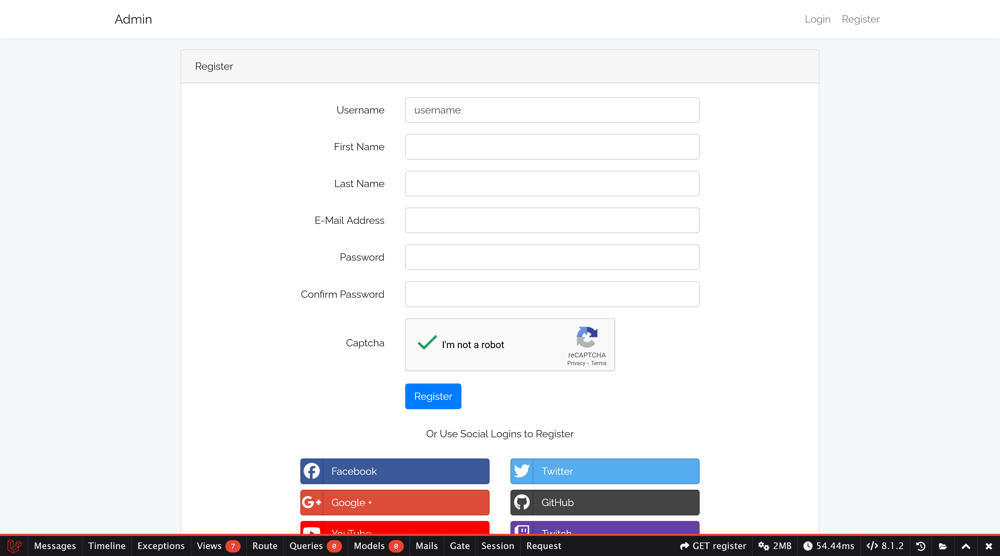
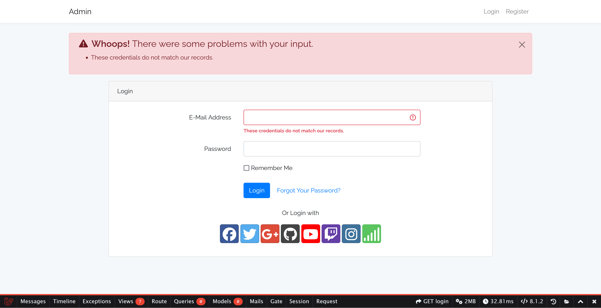
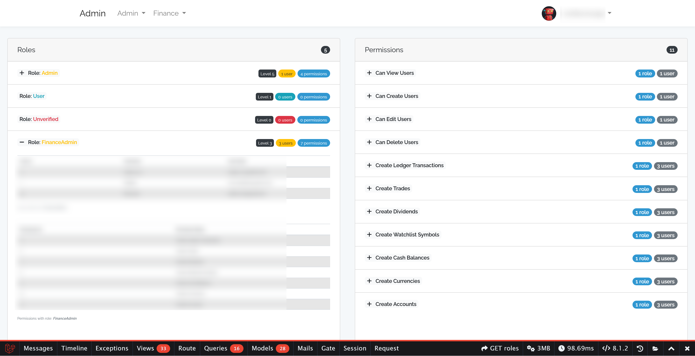
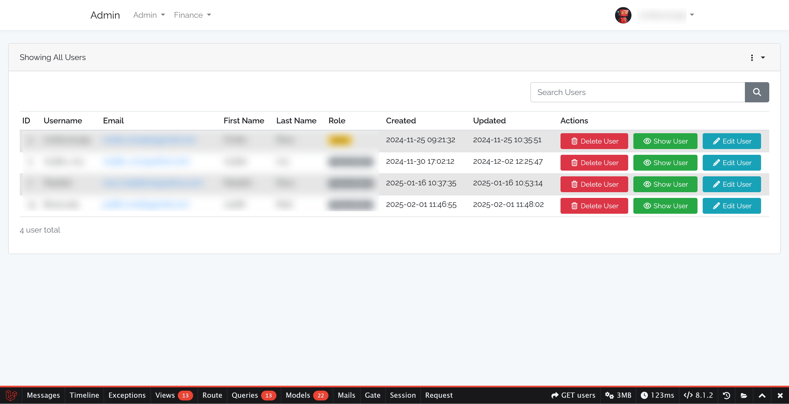
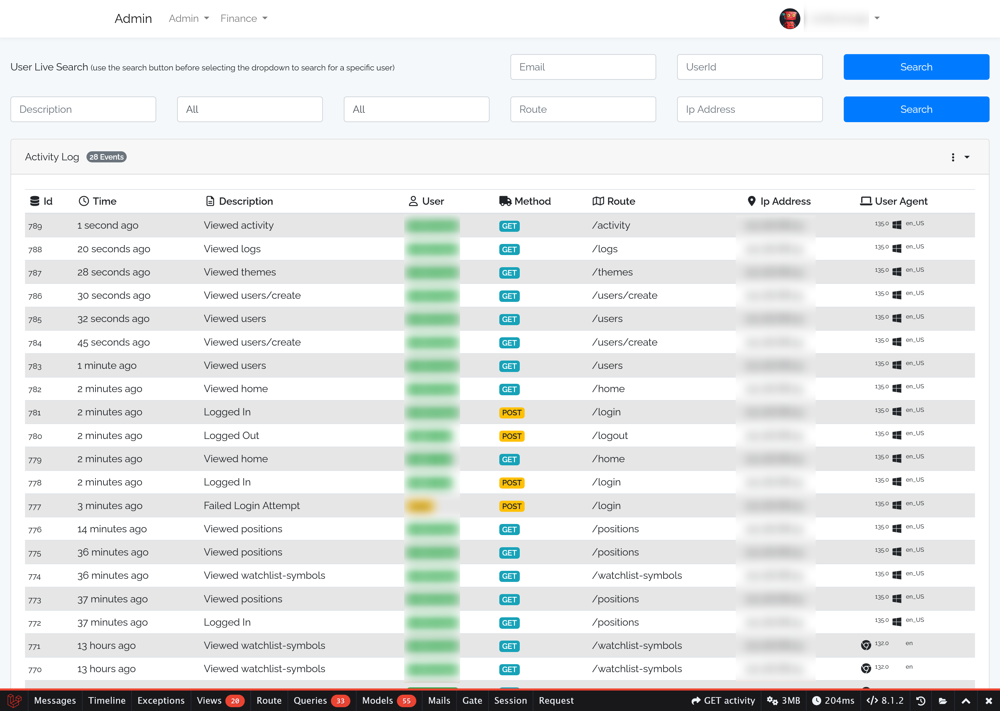

# Laravel Admin

Laravel application for managing accounts and their assets

- user registration with email confirmation, authentication and password recovery, profile management
- roles administration
- users administration
- themes
- log files
- activity log
- PHP information
- routing details
- blocker

## Images











More images in the [images folder](images).

## Original Source

Forked from [jeremykenedy/laravel-auth](https://github.com/jeremykenedy/laravel-auth) from Nov 17, 2024.

Updated (sync fork) on Dec 26, 2025; note that this project is upgraded to Bootstrap 5.3 while the original project is still on Bootstrap 4.

Please check the original [README.md](README-laravel-auth.md).

## Installation instructions

```bash
# PHP 8.2 (ondrej PPAs) with Apache
sudo apt update
sudo apt-get install software-properties-common
sudo add-apt-repository ppa:ondrej/apache2
sudo add-apt-repository ppa:ondrej/php
sudo apt update
sudo apt-get install php8.2 php8.2-cli libapache2-mod-php8.2 php8.2-mysql php8.2-curl php8.2-intl php8.2-mbstring \
    php8.2-gd php8.2-xml php8.2-bcmath htop colordiff
sudo update-alternatives --set php /usr/bin/php8.2
# sudo a2dismod php8.1 # only when upgrading from an older PHP
sudo a2enmod php8.2
sudo systemctl restart apache2
php --version

mysql -uroot -p
    CREATE DATABASE [DB_DATABASE];
    CREATE USER '[DB_USERNAME]'@'localhost' IDENTIFIED WITH mysql_native_password BY '[DB_PASSWORD]';
    GRANT ALL PRIVILEGES ON [DB_DATABASE].* TO '[DB_USERNAME]'@'localhost';
    exit

mysql -u[DB_USERNAME] -p [DB_DATABASE] # use [DB_PASSWORD] set above


cp .env.example .env
vim .env # update the settings

mkdir -p storage/framework/cache/data/
mkdir -p storage/app/
sudo chown -R $USER:www-data storage/
sudo chown -R $USER:www-data storage/framework/cache/data/
sudo chown -R $USER:www-data storage/app/
sudo chmod -R 775 storage/app/

cd storage/
mkdir -p framework/{sessions,views,cache/data,testing}
chmod -R 775 framework
chown -R $USER:www-data framework
cd ..
php artisan cache:clear

# Set default ACLs on storage/framework so any new file created there (by www-data
# or your user) automatically inherits read/write access for both. This is a
# one-time setup that prevents "Permission denied" cache errors without needing
# to re-run chown/chmod after every cache clear or deployment.
sudo setfacl -R -m u:$USER:rwX,u:www-data:rwX storage/framework/
sudo setfacl -R -d -m u:$USER:rwX,u:www-data:rwX storage/framework/

sudo chown $USER:www-data bootstrap/cache
# sudo chmod -R 755 ../laravel-admin # if the web server cannot read the repository

# admin-mydata is private: set up the Bitbucket OAuth keys first (see "Setup the private bitbucket repository"),
# or remove the package (see "Optional packages")
composer update

# If you have a database dump, use that, otherwise setup the basic things
php artisan vendor:publish --tag=laravelroles
php artisan vendor:publish --tag=laravel2step
php artisan key:generate
php artisan migrate
composer dump-autoload
php artisan db:seed # also seeds the sample blockers (BlockedTypeTableSeeder, BlockedItemsTableSeeder)
# The blocker migrations and seeders are already in database/; to refresh them from the package (e.g. after
# upgrading jeremykenedy/laravel-blocker):
# php artisan vendor:publish --tag=laravelblocker-migrations
# php artisan vendor:publish --tag=laravelblocker-seeders

# Front end assets: see "Build the Back End and Front End Assets" below
```

## Build the Back End and Front End Assets

```bash
cd ~/Repositories/laravel-admin
git pull

# Same Composer version everywhere, else 'composer update' rewrites plugin-api-version in composer.lock
sudo composer self-update 2.9.2

# PHP dependencies (composer's post-update-cmd also publishes MyFinance2's assets to public/vendor/myfinance2)
composer update
php artisan optimize:clear

# Database changes: preview them, then apply
php artisan migrate --pretend
php artisan migrate

sudo chown $USER:www-data -R storage/app/
sudo chmod 775 -R storage/app/charts/

# Front end assets
yarn install
yarn run prod
# Local front end work: 'yarn run dev' serves this app's SCSS / JS from the Vite dev server, with hot reload and a
# page refresh on Blade changes (refresh: true in vite.config.js). It keeps running: stop it with Ctrl+C (that removes
# public/hot, else the pages keep asking the stopped server for assets), then 'yarn run prod' again. It does not cover
# MyFinance2's assets: they are prebuilt in its dist/ ("Assets" in its README).
# yarn run dev

# Tests, on this database: every test rolls back, and a run that leaves rows behind fails.
# MyFinance2's tests run with its own dev dependencies (vendor/ovidiuro/myfinance2/vendor/); 'composer update' there
# installs them and keeps them in step with each new release of the package (a no-op when nothing changed).
# One test only: php artisan test --filter test_users_can_authenticate_using_the_login_screen
cd ~/Repositories/laravel-admin && php artisan config:clear && php artisan test && (cd vendor/ovidiuro/myfinance2 && composer update && vendor/bin/phpunit)

# Clear cache
sudo chown $USER:www-data -R storage/framework/cache/data
php artisan config:clear && php artisan cache:clear && sudo systemctl restart apache2

# Populate the returns cache
sudo su - www-data -s /bin/bash -c "export LOG_CHANNEL=stdout; cd /home/$USER/Repositories/laravel-admin/ && php artisan app:finance-api-cron --refresh-returns --force"

# Start the logs afresh (truncating keeps their owner and permissions) and watch the next cron runs
>storage/logs/laravel.log >storage/logs/finance-api-cron.log >storage/logs/stats-cron.log
tail -f storage/logs/*.log
```

## Optional packages

Both packages are optional; the app runs, and its tests pass, without them (their tests skip):

- **ovidiuro/myfinance2** (public): the finance features. Install it by following its README; without it,
  `composer remove ovidiuro/myfinance2`.
- **ovidiuro/laravel-package-admin-mydata** (private, Bitbucket, see "Setup the private bitbucket repository"): this
  deployment's backup table list, schema dumps, private config and test data. Without access to it,
  `composer remove --dev ovidiuro/laravel-package-admin-mydata`.

### admin-mydata coupling points

admin-mydata writes the table data into `php artisan schema:dump` itself (its own `SchemaDumped` listener), so this
app's `composer.json` has no entries for it besides the requirement.

The Returns regression tests (`tests/Packages/MyFinance2/ReturnsEndpointRegression*`) compare /returns with this
deployment's real figures, kept in admin-mydata (`Testing/MyFinance2TestData`). `config/test-data.php` names that
class: a published copy of admin-mydata's, read directly because PHPUnit's data providers run before the app boots.
Without admin-mydata the tests skip.

### MyFinance2 coupling points

The app references the package only through these coupling points, all inert without it: the gates in
`app/Providers/AuthServiceProvider.php`, `config/myfinance2.php` (middleware, navbar registry, this app's layout and
its section names), the `financeadmin` / `unverifiedfinanceadmin` roles given to registrations with
`?myfinance2_invite_token=` (`MYFINANCE2_INVITE_TOKEN`, `config/auth.php`), Laravel's `Verified` event fired on
activation, on which the package seeds the starter currencies, and this app's Vite bundle
(`resources/assets/js/bootstrap.js`), whose jQuery, Bootstrap, DataTables and selectize the finance pages use; the
package brings the rest (`public/vendor/myfinance2`, republished on `composer update`). When the package is installed,
this app's daily log digest uses its email layout (`app/Mail/DailyLogErrors.php`) and `emails:samples` adds its
samples (`app/Console/Commands/EmailSamples.php`); without it they fall back to this app's own.

## Cleanup after full install

After you registered and ensured that everything works fine, clean up the default users.

```bash
mysql -u[DB_USERNAME] -p [DB_DATABASE] # use [DB_PASSWORD] set above
    select * from users;
    delete from users where id <> [YOUR_USER_ID];

    select * from role_user;
    delete from role_user;

    select * from roles;

    -- Make yourself an admin
    insert into role_user (role_id, user_id, created_at, updated_at) values (1, [YOUR_USER_ID], now(), now());
```

## Disable register by uncommenting the following line

```bash
vim routes/web.php
######################
Auth::routes([
    // 'register' => false, // Disable register by uncommenting this line
]);
######################
```

## Setup the private bitbucket repository

1. Login on bitbucket
1. Your profile >> All workspaces >> Manage >> OAuth consumers >> Add consumer
    - name: [SUBDOMAIN].[DOMAIN].[TLD]
    - check 'This is a private consumer'
    - check Repositories.Read
1. Copy the Key & Secret into auth.json

```bash
mkdir -p ~/.composer/; cp auth.json.example ~/.composer/auth.json
vim ~/.composer/auth.json
```

## Scripts

### sync-prod-db.sh

Dumps production tables to localhost. Optionally reimports full schemas first, either from the local git repo (default) or freshly dumped from production via `artisan schema:dump` (`--fresh-schemas`).
Requires `sshpass` and `PROD_*` / `PROD_SYNC_*` keys in `.env` (see `.env.example`).

```bash
bash scripts/sync-prod-db.sh                  # schemas from git repo
bash scripts/sync-prod-db.sh --fresh-schemas  # schemas dumped live from production
```

## Artisan Commands

### activations:clean

Deletes activation records older than 72 hours. Runs daily at midnight.

```bash
sudo su
crontab -e

#############
# Purpose: Deletes stale activation records older than 72 hours

00 00 * * * su - www-data -s /bin/bash -c "export LOG_CHANNEL=stdout; cd [USER_HOME]/Repositories/laravel-admin/ && php artisan activations:clean >> /dev/null 2>&1"
#############
```

### logs:email-daily-errors

Emails a summary of all WARNING / ERROR / CRITICAL / ALERT / EMERGENCY entries from the previous day across all three log files (`laravel.log`, `finance-api-cron.log`, `stats-cron.log`). Each matching entry includes 5 lines of context before and after. The subject starts with the same prefix as the MyFinance2 emails, `[APP_NAME-APP_ENV]` (e.g. `[Admin-PROD]`, `[Admin-LOCAL]`; just `[Admin]` when `APP_ENV=production`), followed by the counts: `[Admin-PROD] Daily Log Errors 2026-10-21 => 1 issue, 2 occurrences`. It uses the MyFinance2 emails' shared layout when that package is installed, else the main app's fallback (`resources/views/emails/layouts/base.blade.php`).

```bash
sudo su
crontab -e

#############
# Purpose: Daily email digest of WARNING and above log entries from the previous day
# Runs at 07:00 daily

00 07 * * * su - www-data -s /bin/bash -c "export LOG_CHANNEL=stdout; cd [USER_HOME]/Repositories/laravel-admin/ && php artisan logs:email-daily-errors >> /dev/null 2>&1"

# Run the job 450s after reboot
@reboot sleep 450 && su - www-data -s /bin/bash -c "export LOG_CHANNEL=stdout; cd [USER_HOME]/Repositories/laravel-admin/ && php artisan logs:email-daily-errors >> /dev/null 2>&1"
#############
```

```bash
# Run manually for yesterday
php artisan logs:email-daily-errors

# Run manually for a specific date
php artisan logs:email-daily-errors --date=2026-05-16
```

### emails:samples

Sends one sample of every email to check how they look in a mail client: the main app's daily log errors digest
(from sample figures) and, when MyFinance2 is installed, each of its emails, which the package builds (see "Emails" in
the myfinance2 README for what each one is, what sends it and which data the sample reads). Persists nothing, so the
real alert crons are unaffected. A kind with no data today is skipped. The exception email is not included (it is sent
only on a real exception). Not scheduled; run it on demand.

```bash
# List what would be sent (subjects only), without sending
php artisan emails:samples --dry-run

# Send every sample (default recipient: the MyFinance2 alerts address, else the user's email)
php artisan emails:samples --to=you@example.com

# Only some kinds, from a given user's data (default: the first user)
php artisan emails:samples --only=price-alert,peak-proximity,daily-log-errors --user-id=1
```

Kinds: every MyFinance2 kind (listed in its README and by `--dry-run`), then `daily-log-errors` (main app).

## Other Utilities

```bash
# After syncing the fork (upstream jeremykenedy/laravel-auth is still on Bootstrap 4), convert its views to
# Bootstrap 5's data attributes
cd resources/views/vendor/
grep -rl data-target . | xargs sed -i 's/data-target/data-bs-target/g'
grep -rl data-toggle . | xargs sed -i 's/data-toggle/data-bs-toggle/g'
grep -rl data-dismiss . | xargs sed -i 's/data-dismiss/data-bs-dismiss/g'
grep -rl data-original-title . | xargs sed -i 's/data-original-title/data-bs-original-title/g'

# Check vendor overwrite path (Look for publishFiles and use error_log to see the path)
vim vendor/jeremykenedy/laravel-logger/src/LaravelLoggerServiceProvider.php
vim vendor/jeremykenedy/laravel-blocker/src/LaravelBlockerServiceProvider.php
```
